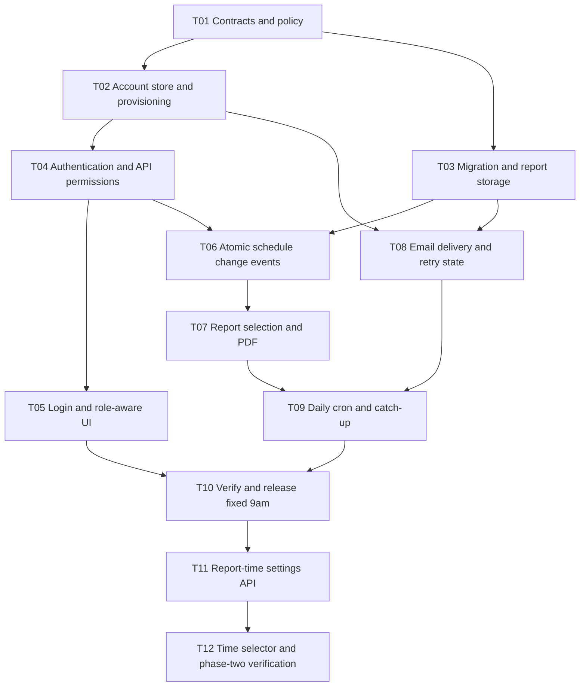

# Authentication and daily schedule reports implementation plan

Specify JSON-backed authentication, role permissions, and a daily PDF email report for
the existing availability scheduler. Deliver fixed 9:00 a.m. reporting first, then add
a manager time selector. This is an implementation specification; no feature code is changed.

## Current implementation

The app uses React, Express, TypeScript, Zod, and a single JSON schedule store. The store
in `server/store.ts` commits complete replacements atomically within one Node process.
`server/app.ts` composes injectable routes; `server/index.ts` starts the API process.
`shared/constants.ts` sets the scheduling timezone to `America/Chicago`.

There is no authentication, change history, email delivery, or background scheduler.
Availability searches calculate results; they do not create availability records. For this
feature, "availability added" means saved changes to recurring weekly working windows.
Date-specific additions are overrides and appear in their own report section.

## Scope and proposed defaults

The organization and access rules below are confirmed requirements. Other defaults resolve
details absent from the request and can be revised before implementation.

- Support exactly one organization unit. All accounts and staff belong to that organization;
  no organization switching, tenant IDs, or cross-organization permissions are needed.
- Users are staff members, each linked to exactly one existing staff ID. Everyone signed in
  can view all staff and their schedules. Users can edit only their own schedule; Managers
  can view all users and edit anyone's schedule. Managers do not require a staff association.
- All active managers receive the same organization-wide report, emailed separately.
- Send every day at 09:00 in `America/Chicago`, including weekends and days with no changes.
- Include weekly availability and override additions, updates, and removals. Reporting only
  additions would hide changes that remove available time. Appointment changes are excluded
  from the first report version, but existing appointment functionality remains available.
- Track changes after migration; existing schedules become the baseline, not new additions.
- Provision accounts through a local administrator script. Self-registration, password reset
  emails, account-management screens, and additional roles are outside the first release.
- Run one always-on API process against local JSON files. Multiple API replicas require a
  different coordination/storage design and are outside this implementation.
- Phase two adds one shared organization-wide report time, editable by any manager.

## Role permissions

Authorization must run on the API for every request, independently of visible UI controls.

| Capability | User | Manager |
| --- | --- | --- |
| Log in, inspect session, log out | Yes | Yes |
| List staff and read schedules | All staff | All staff |
| Search availability | All staff | All staff |
| Edit weekly availability and overrides | Own staff only | All staff |
| Create and cancel appointments | Own staff only | All staff |
| Create staff records | No | Yes |
| Receive daily PDF report | No | Yes |
| Change report time in phase two | No | Yes |

Anonymous API requests return 401. Authenticated disallowed operations return 403.
Users reading another staff member's schedule are allowed; attempts to modify it return 403.
Unknown staff IDs return 404. Treat availability search as a read operation even though its
existing endpoint uses POST. Appointment creation and cancellation are schedule edits and
follow the same ownership rule. Account credentials remain private regardless of role.
Creating a staff record does not automatically create a login account.

## Authentication specification

Store accounts in `data/users.json`, using a versioned envelope with a `users` array.
Each account contains `id`, normalized unique `username`, `displayName`, `email`, `role`,
optional `staffId`, `active`, `createdAt`, and a structured `passwordHash`.
Manager emails are required and validated. A User must reference an existing staff record.

Use asynchronous scrypt with a random per-password salt. Store the algorithm, work parameters,
salt, and derived hash; never plaintext or reversible passwords. Compare hashes in constant
time. Node provides these primitives in its [crypto API][crypto]. Set and benchmark bounded
work parameters during implementation, and validate hash records before allocating resources.

Use random opaque session tokens in an HttpOnly, SameSite=Lax cookie. Enable Secure cookies
over production HTTPS. Store token digests and an eight-hour absolute expiry in API memory;
an API restart signs everyone out. Rotate the token on login and invalidate it on logout.
Recheck account activation and role on authenticated requests. Protect mutations with a
same-origin check and CSRF token. Apply a bounded login rate limit and generic login errors.

Add these endpoints before the protected business routes:

| Endpoint | Contract |
| --- | --- |
| `POST /api/auth/login` | Username/password in; session cookie and safe account profile out |
| `GET /api/auth/me` | Safe account profile and CSRF token; 401 without a valid session |
| `POST /api/auth/logout` | Invalidate session and clear cookie; 204 |

Never expose hashes, salts, or session tokens in profile responses or logs. Keep account JSON
outside the static directory, ignored by Git, and use restrictive file permissions. Provision
passwords through a hidden prompt, not command arguments or checked-in demo credentials.

## Persistence and change tracking

Migrate the schedule envelope to version 2, preserving all staff, weekly schedules, overrides,
and appointments. Add `reportingStartedAt`, `nextChangeSequence`, and `changes`. Back up the
version 1 file before migration. Validate both formats; fail visibly on corrupt or unknown
formats. Update the seed script so it cannot silently replace migrated data.

Each change event contains:

- Stable event ID, monotonically increasing sequence, and UTC `occurredAt`.
- Actor account ID and name snapshot; affected staff ID and name snapshot.
- Entity type (`weekly` or `override`) and operation (`created`, `updated`, `deleted`).
- Target weekday or ISO date, plus normalized `before` and `after` values.

For weekly windows, an empty-to-nonempty change is created; nonempty-to-empty is deleted;
other differences are updated. Override classification compares the existing date entry.
Identical saves and deletion of an absent override produce no event. An availability search
never produces an event. Preserve individual committed edits, including changes later undone.

Extend the repository mutation boundary to accept trusted actor metadata and write the
schedule change and its event in the same atomic JSON replacement. Do not write audit events
as a second file operation after saving the schedule. Failed writes must publish neither
the edited schedule nor its event. Retain the current synchronous mutation/booking checks.

Store report jobs, per-recipient delivery status, and later settings in a separate versioned
`data/reports.json`. All writes must merge against current state through one repository;
asynchronous email completions must not overwrite other recipients' progress.

## Daily report specification

At a scheduled cutoff, build an immutable report model from committed events. Use successive
local 09:00 boundaries, converted to UTC, with half-open intervals `[start, end)`. A change
exactly at 09:00 belongs to the next report. Do not subtract a fixed 24 hours across DST.
The first interval begins at `reportingStartedAt`; no historical changes are invented.

Persist a job before sending, including its cutoff, interval, event IDs or frozen model,
recipient IDs and email snapshots, and per-recipient status. Events committed after the
cutoff are left for the next interval. Retry the same frozen report without recalculating it.
Track job creation separately from email success so one failed recipient cannot block future
days or cause repeated delivery to successful recipients.

Generate a PDF Buffer using PDFKit, which provides a stream-based document API.
See [PDFKit getting started][pdfkit]. The report contains:

1. Title, reporting interval, timezone, generation timestamp, and stable report ID.
2. Summary counts by staff member and change category.
3. Weekly availability changes grouped by staff and weekday, showing before and after windows.
4. Override changes grouped by staff and date, with mode, windows, actor, and change time.
5. An explicit "No schedule changes" message when the interval is empty.

Use readable local time labels, chronological event order within each group, repeated table
headers on page breaks, wrapping for long names, and page numbers. Do not clip rows across
pages. Include all three override modes: `add`, `replace`, and `unavailable`.

Email subject: `Daily schedule changes - YYYY-MM-DD`. Include a short count summary in the
body and attach `schedule-changes-YYYY-MM-DD.pdf` with MIME type `application/pdf`.
Use an injectable SMTP mail adapter; Nodemailer is the proposed implementation.
See [Nodemailer usage][mail]. Read SMTP host, port, TLS settings, credentials, and sender
from environment variables. Development and tests use a capture transport, never real mail.

## API cron and delivery behavior

Register a daily `0 9 * * *` job in `server/index.ts` after storage/configuration is ready.
Use an explicit `America/Chicago` timezone and prevent concurrent executions. The proposed
node-cron adapter supports timezone and overlap options; see [scheduling options][cron].
Keep cron registration out of `createApp` so route tests never start background jobs.

Inject a clock, scheduler, report builder, and mailer into the reporting service. On shutdown,
stop new executions and allow a bounded drain of active sends. Missing production SMTP
configuration must produce a visible startup error when reporting is enabled.

- Give each scheduled cutoff one durable job key. Repeated callbacks reuse that job.
- Persist `pending`, `sending`, `sent`, or `failed` per recipient, with attempt count,
  attempt time, delivery response ID where available, and a sanitized error.
- Retry failed sends after 1, 5, and 15 minutes; after exhaustion, retain a visible failure
  for an administrator retry command. Retry only recipients without confirmed success.
- On startup, reconcile missed daily cutoffs since the last created job and enqueue them
  chronologically. Resume unfinished jobs using saved retry state. No catch-up occurs
  before the reporting baseline. Recheck recipient activation/manager role before sending.
- Persist a job even when no managers exist; log it as having no eligible recipients.
- Ordinary retries must not duplicate confirmed deliveries. SMTP cannot guarantee exactly
  once: a crash after provider acceptance but before saving `sent` may lead to a duplicate.
  Reuse a stable Message-ID and report ID, and document this remaining failure window.

An in-process cron cannot send while the API is stopped. Startup catch-up makes missed reports
recoverable, but cannot promise on-time delivery during downtime. Keep JSON histories for this
small demonstration; define archival before sustained production usage.

## Task dependency DAG

An arrow means the source task must finish before the target starts. Independent branches
can be implemented concurrently. The editable diagram is
`../auth-and-daily-reports-dag.drawio`; this graph uses the same nodes and edges.

## Step by step implementation tasks

| Task | Depends on | Deliverable and completion check |
| --- | --- | --- |
| T01 | None | Define roles, profile/event/job schemas, permission matrix, and report interval rules. Record the proposed defaults above in requirements. |
| T02 | T01 | Build validated atomic account storage and a provisioning script. Verify unique usernames, salted hashes, staff links, manager emails, and failed-write rollback. |
| T03 | T01 | Migrate schedule storage and add report-job storage. Test version 1 preservation, repeat startup, unknown versions, corrupt input, and backup recovery. |
| T04 | T02 | Add login/session/logout, CSRF, rate limits, and route authorization. Verify both roles can read all schedules and search availability; Users can mutate only their own, while Managers can mutate any schedule. Cover every existing route. |
| T05 | T04 | Add login/logout and session expiry handling. Show all staff to both roles; make other staff schedules read-only for Users, including booking controls. Managers can edit every schedule. Clear prior-user data on logout and ignore stale responses after identity changes. |
| T06 | T03, T04 | Capture weekly and override events inside the atomic mutation. Test actors, before/after values, no-op saves, removals, and persistence failures. |
| T07 | T06 | Build a pure interval selector and PDFKit renderer. Test exact boundaries, all override modes, reverted edits, empty reports, and multi-page reports. Inspect a rendered PDF. |
| T08 | T02, T03 | Add mail adapter, frozen job/recipient records, and durable retry state. Verify attachment metadata, partial failures, no recipients, and restart recovery with captured mail. |
| T09 | T07, T08 | Compose reporting service and API cron. Test Chicago 9am, DST, overlapping callbacks, downtime catch-up, repeat callbacks, and shutdown using a fake clock. |
| T10 | T05, T09 | Complete integration/browser checks, update setup/API/architecture docs, and demonstrate the fixed 9am workflow. This is the phase-one release gate. |
| T11 | T10 | Add persisted shared report-time settings and manager-only GET/PUT endpoints. Validate HH:mm and reschedule without overlaps, lost intervals, or old timers. |
| T12 | T11 | Add manager time input with timezone label, save feedback, and persisted value on reload. Verify User rejection and new-time execution end to end. |

One valid execution sequence is T01; T02 and T03; T04 and T08; T05 and T06; T07;
T09; T10; T11; T12. These are dependency waves, not duration estimates.

## Suggested code locations

- Extend `shared/contracts/persistence.ts` and `shared/schemas.ts` for storage migration;
  put client-safe auth/settings contracts under `shared/contracts/`.
- Add server-only account/hash/session schemas under `server/auth/`, with an account store,
  password service, session service, and permission middleware.
- Add `server/routes/auth-routes.ts`; protect routes in `server/app.ts` before staff lookup.
- Extend `server/store.ts` and `server/routes/schedule-routes.ts` for actor-aware change capture.
- Add `server/reports/` modules for job storage, selection, PDF rendering, delivery, and cron.
- Add `src/features/auth/`; update `src/app.tsx`, staff controls, and `src/shared/lib/api.ts`.
- In phase two add `server/routes/report-settings-routes.ts` and `src/features/report-settings/`.
- Extend the existing API, storage, and Playwright suites with authenticated fixtures.

## Phase two report time behavior

Add manager-only `GET /api/report-settings` and `PUT /api/report-settings` with
`{ localTime: "09:00", timezone: "America/Chicago" }`. The timezone is read-only in this phase.
Persist the setting and its revision before activating the replacement schedule. Reject invalid
times with 400, and keep the prior active setting if persistence fails.

Apply edits to the next occurrence strictly after the save time; saving never immediately
sends a report. The new interval starts at the previous job's cutoff, so moving the time
can produce a shorter or longer interval without dropping events. Existing jobs keep their
original cutoff and retry state. Serialize settings changes with job creation and reject
callbacks from obsolete schedule revisions.

For selected times during DST transitions, run once at the first occurrence of a repeated
local time; shift a nonexistent time to the first valid local time after the gap. Verify this
in the adapter rather than relying on undocumented cron behavior. Persist the next intended
cutoff so restart/catch-up follows the same rule.

## Release acceptance

1. Provision a Manager and two Users linked to different staff in the single organization.
   Verify both roles can list all staff, view every schedule, and search anyone's availability.
   Verify each User can edit their own weekly hours, overrides, and appointments, but sees
   read-only controls for others and receives 403 for direct attempts to edit others' schedules.
   Verify the Manager can edit either User's schedule. No organization selector is present.
2. Save weekly availability, add/update/remove overrides, and confirm the PDF explains each
   committed change with the correct actor and before/after values.
3. Advance an injected clock through Chicago 09:00; each eligible Manager receives one
   captured email with a valid PDF. No User receives it. Verify a no-change day as well.
4. Simulate one failed recipient, restart, and retry; successful recipients are not resent.
   Simulate missed cutoffs and check that every event belongs to exactly one report interval.
5. Confirm migration preserves old bookings and all existing scheduling behavior still works.
6. Run `npm run verify` and `npm run test:e2e` with capture mail and isolated JSON fixtures.
7. After the phase-one gate, change the report time as Manager and verify persistence,
   authorization, DST behavior, and cancellation of the previous timer.

[crypto]: https://nodejs.org/api/crypto.html#cryptoscryptpassword-salt-keylen-options-callback
[pdfkit]: https://pdfkit.org/docs/getting_started.html
[mail]: https://nodemailer.com/usage/
[cron]: https://www.nodecron.com/scheduling-options.html
